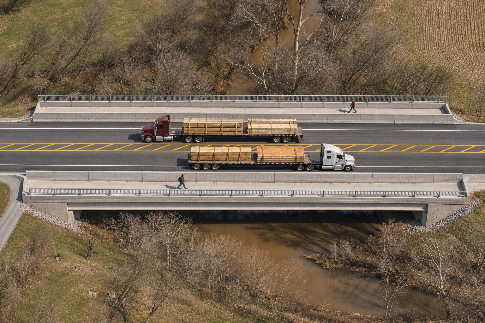

When two school buses approach the Caney Creek bridge from opposite directions, one driver has to wait. At an October 2024 meeting at Caneyville City Hall, Grayson County Schools Transportation and Safety Director Braxton Allen said all 12 of the district’s Caneyville buses use the bridge. Drivers schedule their crossings around one another because there simply isn’t room to pass.

“It’s just a safety issue for us,” Allen said.

In April 2026, Caneyville got the funding its leaders had sought. Kentucky’s road plan sets aside **$2.79 million** to replace and widen the U.S. 62 bridge. It puts construction in fiscal year 2028, which runs from July 2027 through June 2028. The plan gives no date for contractors to bid or for crews to arrive on Beaver Dam Road. Two years after that City Hall meeting, Caneyville deserves an update from the Kentucky Transportation Cabinet.

## Why local leaders brought Frankfort to the bridge

Built in 1927, the Beaver Dam Road bridge stands between the center of Caneyville and Caneyville Elementary School. Drivers have about 19 feet of roadway between the curbs. Warning signs stand at both ends. If you meet a truck there, the two of you have to judge who can cross first.

That was what local leaders wanted Sen. Jimmy Higdon, then chair of the Senate Transportation Committee, to see in October 2024. Sen. Steve Meredith explained why the bridge had been easy to overlook on a statewide replacement list. Its structure was sound, but its width made it a daily problem on the road to an elementary school. After seeing the crossing, Higdon agreed it belonged in the road plan.

Mayor James Embry, the City Commission, Grayson County Judge-Executive Kevin Henderson, school officials and residents helped make the case. Meredith and Rep. Samara Heavrin carried it to Frankfort. City Commissioner Mike Geary also asked for sidewalks so people could walk safely between the school and businesses on either side of the creek.

## The money is in the plan. Where does the project stand?

Kentucky lists the bridge as Grayson County item **80406**. Here’s how lawmakers divided the money in [House Bill 502, page 56](https://apps.legislature.ky.gov/law/acts/26RS/documents/0145.pdf#page=56).

| Phase | Fiscal year | Amount |
| --- | --- | --- |
| Design | 2026 | $250,000 |
| Right-of-way | 2027 | $20,000 |
| Utilities | 2027 | $120,000 |
| Construction | 2028 | $2,400,000 |
| **Total** | | **$2,790,000** |

The first question for KYTC District 4 is how much of the design is complete. What still has to happen before contractors can bid? Which steps could move sooner? A public update at City Hall would give bus drivers, parents, nearby businesses and emergency responders a chance to weigh in on the design and any detour while there’s still time to change them.

## One possible design for the Caney Creek bridge

*Concept rendering. The [November 2026 study](/blog/assets/caney-creek-bridge/replacement-study.pdf) illustrates one possible replacement, with a six-foot protected sidewalk on each side. The state road plan calls for replacement and widening and leaves the layout open.*

If you drive a school bus, haul a load or cross on foot, **share this article on Facebook or in your Grayson County community group** and tell people what happens when you meet traffic coming the other way. Those firsthand accounts helped put this bridge in the state road plan. Now let’s ask KYTC to come back to Caneyville and tell us when the work can begin.
